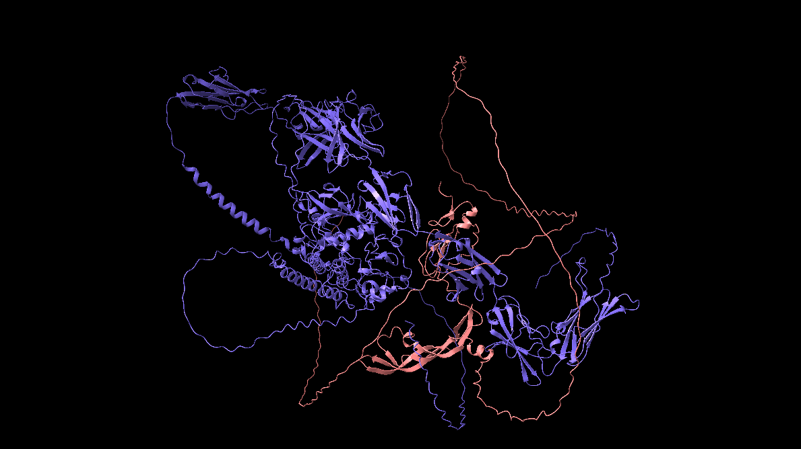
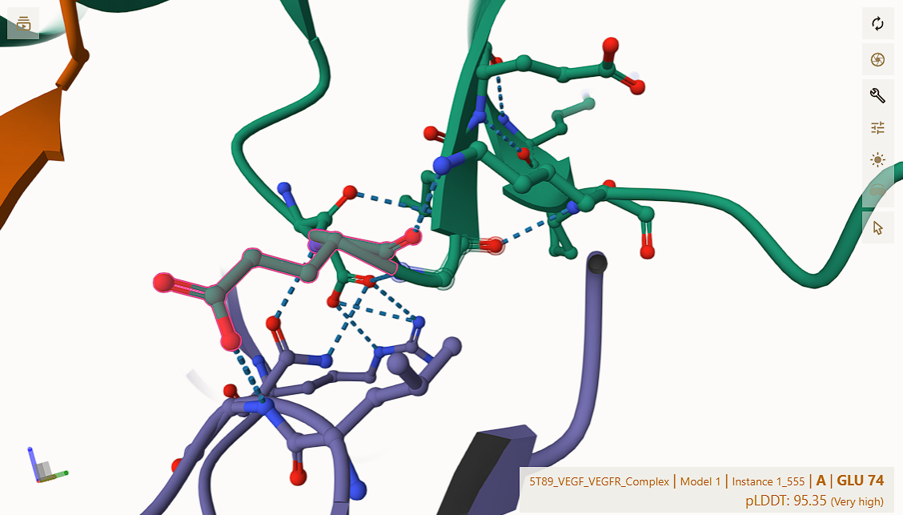
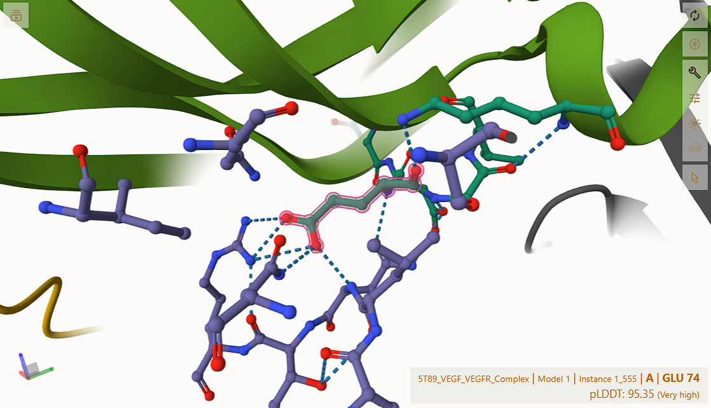
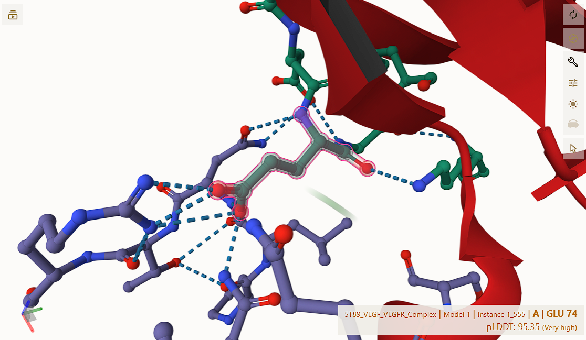

# Modeling Antibody–Antigen Interactions Using AlphaFold3

**Final Project Report — MATH F376 Design Project** 

Birla Institute of Technology and Science, Pilani — Hyderabad Campus
April 2026

**Authors:**
Shubh Srivastava (2022B4A70664H),
Atharva Chaphekar (2022B4A71815H),
Ruchi Harge (2022B4A70942H),
Rithika Balusu (2022B1A70938H)

**Supervisors:** Prof. Prajakta Bedekar, Prof. Satyanarayana Subrahmanyam

---

## Abstract

This project investigates whether AlphaFold3 (AF3) can be used as a virtual laboratory for studying antibody-mediated inhibition of antigen binding. We focus on the vascular endothelial growth factor A (VEGFA) and its receptor VEGFR — a clinically important interaction targeted by the anti-angiogenic antibodies Bevacizumab and Ranibizumab.

The project is organised around two phases:

- **Pre-midsem (Phase 1).** Validate the AF3 pipeline on the BITS Hyderabad HPC cluster, reproduce the wild-type VEGFA–VEGFR complex (PDB 5T89), and probe whether adding the Bevacizumab Fab or Ranibizumab competes with VEGFR for VEGFA.
- **Post-midsem (Phase 2).** Move from "does the antibody bind" to "what makes the binding interface essential". We performed a *saturation mutagenesis scan* at VEGFA residue Glu 74 — the residue that contributes the largest cluster of inter-chain hydrogen bonds in the wild-type interface — submitting one AF3 prediction for each of the 19 alternative amino acids using SLURM job arrays, and quantitatively comparing the resulting interfaces using AF3 confidence metrics, ChimeraX-derived H-bond / contact maps, and OpenMM Amber19 potential energies.

We find that AF3 can reliably reproduce the wild-type VEGFA–VEGFR interface (ipTM = 0.83, ranking score = 0.89), that the Bevacizumab Fab does not displace VEGFR in the predicted ternary complex (ipTM drops only modestly, from 0.89 to ~0.39 because of the much larger system, but the VEGFR–VEGFA contact pattern is preserved), and that the Glu 74 saturation scan produces a clear residue-rank ordering of binding-interface preservation that is reflected both in AF3 ranking scores and in OpenMM energies. Together these results show that AF3 + ChimeraX + OpenMM is a workable, low-cost pipeline for residue-level antibody / antigen / receptor engineering studies.

---

## Contents

1. Introduction
2. Background — AlphaFold3
3. Project Overview & Objectives
4. Computational Infrastructure
5. Methods
   - 5.1 AF3 Input Format
   - 5.2 Single SLURM Job
   - 5.3 SLURM Job Arrays (saturation scans)
   - 5.4 Best-Model Selection
   - 5.5 ChimeraX Contact and H-bond Analysis
   - 5.6 OpenMM Potential-Energy Evaluation
6. Phase 1 — Pre-Midsem Experimental Runs
   - 6.1 Run 1 — Single-chain pilot
   - 6.2 Run 2 — Dimerised VEGFA / VEGFR (reference complex)
   - 6.3 Run 3 — Bevacizumab Fab studies (demo3)
   - 6.4 Run 4 — Ranibizumab studies (demo4)
7. Phase 2 — Post-Midsem Experimental Runs
   - 7.1 Run 5 — Pilot mutation study at Glu 74 (demo5)
   - 7.2 Run 6 — Saturation mutagenesis at Glu 74 (demo6)
8. Consolidated Results
   - 8.1 Confidence-metric summary across all runs
   - 8.2 Wild-type interface H-bond inventory
   - 8.3 Effect of E74 mutations on the H-bond network
   - 8.4 Saturation-scan ranking + OpenMM energies
9. Discussion
10. Completed Run 7 (`demo7`) — full 20-residue E74 mutation scan
11. Summary
12. Future Work
13. References
14. Appendix A — Chain-ID legend per run
15. Appendix B — Reproducibility / file map
16. Appendix C — Useful ChimeraX commands

---

## 1. Introduction

Understanding biomolecular interactions is central to drug design, immunology and molecular biology. Antibody–antigen interactions in particular drive both natural immune defence and a large fraction of modern therapeutics — ranging from anti-cancer antibodies such as Bevacizumab to antiviral neutralising antibodies developed against rapidly mutating pathogens.

Proteins are built from a fixed alphabet of **20 naturally occurring amino acids**: alanine (A), arginine (R), asparagine (N), aspartic acid (D), cysteine (C), glutamine (Q), glutamic acid (E), glycine (G), histidine (H), isoleucine (I), leucine (L), lysine (K), methionine (M), phenylalanine (F), proline (P), serine (S), threonine (T), tryptophan (W), tyrosine (Y) and valine (V). At any given position in a protein chain, replacing the wild-type residue with each of the other 19 — a *saturation mutagenesis scan* — is the standard way of asking which residue identity is actually required at that site. The Phase 2 work in this report is exactly such a scan, performed *in silico* via AF3 rather than on the bench.

Experimentally determining a protein complex by X-ray crystallography or cryo-EM is slow and expensive. Recent advances in deep learning, in particular DeepMind's **AlphaFold** family, have dramatically lowered the cost of getting a *first-pass* three-dimensional model: for many systems the computational prediction is now accurate enough to support hypothesis generation, mutational design and structural reasoning in advance of any wet-lab work.

AlphaFold3 extends this capability beyond single proteins to multi-molecular assemblies — protein–protein, protein–nucleic-acid and protein–ligand. This makes it attractive for studying the *three-body* problem at the heart of therapeutic antibody design: antigen, receptor, and antibody, and asking whether the antibody can interpose itself between antigen and receptor.

This project takes that question concretely. We use VEGFA (the antigen), VEGFR (the receptor whose binding drives angiogenesis, and whose blockade is the therapeutic goal), Bevacizumab and Ranibizumab (the two antibodies in clinical use against VEGFA), and the BITS Hyderabad HPC cluster. We then ask not just *whether* AF3 can model the complex but, in the second half of the project, *which residues* of VEGFA are required to maintain the receptor interface — a step that is necessary to use AF3 for downstream antibody engineering.

**Long-term vision.** Beyond this specific antibody–antigen system, the same pipeline (AF3 prediction → ChimeraX interface analysis → OpenMM energy → saturation scan over the 20 amino acids) generalises directly to predicting the consequences of mutations in rapidly evolving viral antigens. Vaccine development against a mutating virus is conventionally a long, expensive process — each new variant requires re-isolating the antigen, raising new antibodies, and re-running clinical trials. A virtual saturation-scan pipeline of the kind validated here can, in principle, be re-pointed at a viral spike / receptor / neutralising-antibody triple, and used to enumerate likely escape mutations *before* they appear in the field. The value is not that AF3 replaces the wet-lab work, but that it shortens the design loop: candidate-mutation lists computed in days rather than months, and triaged by both AF3 confidence and force-field energy before any experimental commitment is made. The VEGFA / VEGFR / Bevacizumab system in this report is the validation testbed; the eventual target is the antiviral-vaccine design problem.

---

## 2. Background — AlphaFold3

AlphaFold3 is the latest generation of the AlphaFold framework from Google DeepMind. Where AlphaFold2 was specialised for predicting the structure of a single protein chain, AlphaFold3 generalises to:

- protein–protein assemblies,
- protein–DNA / protein–RNA complexes,
- protein–small-molecule and protein–ligand complexes.

The principal architectural innovation is the integration of **diffusion-based generative modelling** with attention-based neural networks. Earlier predictors refined a deterministic backbone iteratively; AF3 instead samples a noisy atomic configuration and learns to denoise it into a physically plausible assembly. This makes the model intrinsically generative and able to represent flexible conformations and stochastic interface geometries.

Each AF3 prediction returns:

- a best-scoring `*_model.cif` structure,
- per-seed × per-sample variant structures under `seed-N_sample-M/`,
- a `*_ranking_scores.csv` file giving the per-prediction ranking score,
- a `*_summary_confidences.json` containing global confidence metrics — most importantly **ipTM** (inter-chain predicted TM-score), **pTM** (overall predicted TM-score), per-chain pTMs, fraction of disordered residues, and a clash flag.

Throughout this report we use AF3 ranking score and ipTM as the primary confidence indicators. ipTM in particular is a per-complex score that penalises geometrically unrealistic interfaces and is the most informative single number for binding-interface quality.

---

## 3. Project Overview & Objectives

**Goal.** Use AF3 + ChimeraX + OpenMM to study antibody-mediated inhibition of the VEGFA–VEGFR interaction at residue resolution.

**Objectives.**

1. Reproduce the VEGFA–VEGFR wild-type complex (PDB 5T89) using AF3 on HPC and validate it against the experimental structure.
2. Build ternary models that include the Bevacizumab Fab (demo3) and the full Ranibizumab antibody (demo4), and ask whether the antibody's presence disrupts the VEGFA–VEGFR interface.
3. Identify the *most load-bearing residue* on the VEGFA side of the interface using a per-atom contact and H-bond analysis in ChimeraX.
4. Perform a *saturation mutagenesis* at that residue (demo5 + demo6), one AF3 prediction per alternative amino acid, and rank the mutants by AF3 ranking score and by OpenMM Amber19 potential energy.
5. Establish a reusable HPC pipeline (SLURM job arrays + post-processing scripts) so that the same protocol can later be applied to other systems — most obviously, virus-spike / receptor / antibody combinations.

---

## 4. Computational Infrastructure

All AlphaFold3 predictions were run on the **BITS Hyderabad HPC cluster** under the SLURM workload manager, on the `gpu_h100_4` partition (one H100 GPU per job, 8 CPU cores, 100 GB RAM, up to 24 h walltime). When the H100 partition was saturated, jobs were re-submitted to `gpu_a100_8` (A100 GPUs, 5-day walltime — see e.g. `alphafold3_demo2_a100.slurm`).

The container image (`~/alphafold3/alphafold3.sif`) and the AF3 weights and sequence databases were preinstalled at:

- `~/alphafold3/alphafold3_databases` — sequence databases,
- `~/alphafold3/alphafold3_model_params` — model weights,
- `~/af3_input` / `~/af3_output` — bind-mounted into the container as `/input` and `/output`.

Local post-processing (pickling of best-model CIFs, ChimeraX visualisation, OpenMM relaxation/energy) was performed on a Windows workstation using ChimeraX 1.11.1 and OpenMM with the Amber19 force field (`amber19-all.xml`, `amber19/tip3pfb.xml`).

---

## 5. Methods

### 5.1 AF3 Input Format

Each prediction is driven by a hand-written JSON file (`demoN_M.json`) in the AF3 v1 dialect. Minimal example:

```json
{
  "name": "demo6E",
  "modelSeeds": [1, 2, 3],
  "sequences": [
    { "protein": { "id": ["A"], "sequence": "EVVKFMDVYQRSY...CECRPKK"   } },
    { "protein": { "id": ["B"], "sequence": "EVVKFMDVYQRSY...CECRPKK"   } },
    { "protein": { "id": ["C"], "sequence": "RPFVEMYSEIPEII...VHIYD"    } },
    { "protein": { "id": ["D"], "sequence": "RPFVEMYSEIPEII...VHIYD"    } }
  ],
  "dialect": "alphafold3",
  "version": 1
}
```

**Chain-letter convention.** Throughout the project, chain identifiers carry biological meaning and are kept consistent across the JSON, the SLURM job and any downstream ChimeraX selection. The legend differs per run and is documented in the per-run `demoN_stats.txt` file (see Appendix A). In the `demo6E` example above, chains C and D are the VEGFR **D2/D3 binding domains** (residues 134–328), not the full-length VEGFR sequence used in Run 1 / Run 2.

**Chain-end "cutting".** Starting from Run 3, terminal residues that are known to detach during complex formation were trimmed from the input sequences (e.g. VEGFA was supplied as residues 13–108 instead of the full chain). Without this trimming, AF3 attempts to fit the dangling termini somewhere and produces visibly extended ends that bias both visualisation and energy scoring.

### 5.2 Single SLURM Job

Each prediction is launched by a job script in the canonical form below (Run 2 example):

```bash
#!/bin/bash
#SBATCH --job-name=af3_demo2
#SBATCH --partition=gpu_h100_4
#SBATCH --gres=gpu:1
#SBATCH --cpus-per-task=8
#SBATCH --mem=100GB
#SBATCH --time=24:00:00
#SBATCH --output=af3_demo2.out
#SBATCH --error=af3_demo2.err

module load singularity 2>/dev/null || true

INPUT_DIR=~/af3_input
OUTPUT_DIR=~/af3_output
DB_DIR=~/alphafold3/alphafold3_databases
PARAMS_DIR=~/alphafold3/alphafold3_model_params
SIF_FILE=~/alphafold3/alphafold3.sif

singularity run --nv \
  --bind ${INPUT_DIR}:/input  --bind ${OUTPUT_DIR}:/output \
  --bind ${DB_DIR}:/databases --bind ${PARAMS_DIR}:/params \
  ${SIF_FILE} \
  python /app/alphafold/run_alphafold.py \
    --json_path=/input/demo2.json \
    --model_dir=/params --db_dir=/databases --output_dir=/output
```

Submission: `sbatch alphafold3_demo2.slurm`. Output is collected in `~/af3_output/<name>/`, then archived as a `.zip` and downloaded.

### 5.3 SLURM Job Arrays (saturation scans)

For Run 6 we needed 19 independent predictions, one per alternative amino acid at VEGFA position 74. Submitting 19 separate `sbatch` calls is fragile and clutters the queue. We instead used a single SLURM **job array** that consumes the array task ID as an index into an amino-acid table (`demo6/slurm_files_demo6/alphafold3_demo6_all.slurm`):

```bash
#SBATCH --array=0-18
AAS=(A R N D C E G H I L K M F P S T W Y V)
AA=${AAS[$SLURM_ARRAY_TASK_ID]}
...
  --json_path=/input/demo6${AA}.json
```

`sbatch alphafold3_demo6_all.slurm` queues all 19 mutants at once; each array task gets its own GPU allocation and runs independently. Per-letter single-task fallbacks (`alphafold3_demo6A.slurm`, `alphafold3_demo6C.slurm`, …) are kept under the same directory for resubmitting individual mutants without re-running the whole sweep.

### 5.4 Best-Model Selection

AF3 returns five samples per seed × three seeds = 15 candidate structures by default. We pick the highest-ranking one using a small CSV scanner (`5T89_VEGF_VEGFR_Complex/script_best_score.py`) that reads `<name>_ranking_scores.csv` and prints the seed/sample of the maximum `ranking_score`. The pattern is reusable across runs by changing the `file_path` constant.

### 5.5 ChimeraX Contact and H-bond Analysis

The downloaded best-model CIF is loaded into ChimeraX (1.11.1) for residue-resolution interface analysis.

- **Atom-level contacts.** `chimeraX_script.py` enumerates atom–atom distances ≤ 5 Å between two named chains. Constants `CHAIN_1`, `CHAIN_2`, `CUTOFF` are edited at the top of the script. The script must be run *inside* ChimeraX's Python (it imports `chimerax.core.commands.run` and uses the `session` global). The same enumeration can be invoked interactively in the ChimeraX command line:

  ```
  contacts /B restrict /C distanceOnly 4.0 log true
  ```

  `/B` and `/C` are the two chain selectors (edit per chain pair — e.g. `/A` ↔ `/C`, `/A` ↔ `/D`, `/B` ↔ `/C`, `/B` ↔ `/D`), `distanceOnly 4.0` thresholds at 4 Å, and `log true` writes the distances to the ChimeraX log for copy-out.
- **H-bonds.** Captured from the ChimeraX GUI into files such as `input_h_bond.txt` / `contacts_list.txt` using:

  ```
  hbonds /B restrict /D showDist true log true
  ```

  Same convention — change the two chain selectors per pair. `showDist true` annotates each detected H-bond with the donor–acceptor distance, and `log true` echoes the donor / acceptor / D…A distance triples to the log so the table can be lifted out verbatim.
- **Sorting.** `h_bond_sorter.py` rewrites `input_h_bond.txt` in place, sorted by D…A distance (the last float on each line), so the strongest contacts appear first.
- **Cross-model comparison.** `comparison.txt` is the manually curated notebook of ChimeraX outputs across the 5T89 reference and the demo5 mutants — for each model it stores the four `contacts` enumerations and four `hbonds` enumerations covering the A↔C, A↔D, B↔C and B↔D chain pairs (the two VEGFA–VEGFR canonical interfaces and the two diagonal pairs). It is the primary source for the H-bond inventories reproduced in §8.2 and §8.3.

### 5.6 OpenMM Potential-Energy Evaluation

To complement AF3's ranking score with a force-field-based energy estimate, each predicted CIF is loaded into OpenMM, hydrogens are added with `Modeller.addHydrogens`, an Amber19 system is built, and the potential energy of the as-predicted positions is reported. Two scripts implement this — a single-CIF one-shot used during Phase 1 / demo5, and a batch driver used for the demo6 saturation scan.

**Single-CIF version (`openMM/script.py`).** The `5T89_VEGF_VEGFR_Complex_model.cif` filename on line 6 is edited per use to point at whichever model is being scored.

```python
from openmm.app import *
from openmm import *
from openmm.unit import *

# 1. Load the CIF file
cif = PDBxFile('5T89_VEGF_VEGFR_Complex_model.cif')

# 2. Load the force field
forcefield = ForceField('amber19-all.xml', 'amber19/tip3pfb.xml')

# 3. Create a Modeller object and add missing hydrogens
modeller = Modeller(cif.topology, cif.positions)
modeller.addHydrogens(forcefield)

# Now use 'modeller' instead of 'cif' for the topology and positions
system = forcefield.createSystem(modeller.topology, nonbondedMethod=NoCutoff)

# 4. Set up the Simulation
integrator = LangevinIntegrator(300*kelvin, 1/picosecond, 0.002*picoseconds)
simulation = Simulation(modeller.topology, system, integrator)
simulation.context.setPositions(modeller.positions)

# 5. Get and print the Potential Energy
state = simulation.context.getState(getEnergy=True)
print(f"Potential Energy: {state.getPotentialEnergy()}")
```

Key choices: `amber19-all.xml` (protein parameters) + `amber19/tip3pfb.xml` (water model — present so any solvent atoms in the CIF are typed correctly), `NoCutoff` for non-bonded interactions (every pair is evaluated explicitly — this is the right setting for a single small complex), and a Langevin integrator at 300 K (only used to instantiate a `Simulation`; no dynamics are stepped). Hydrogens are added after instantiation because AF3 CIFs are heavy-atom-only.

**Batch / saturation-scan driver (`demo6/script.py`).** Walks every `demo6/demo6*/` subdirectory, applies the same energy recipe to each `*_model.cif`, and writes a TSV to `demo6/output.txt`. The `openMM/demo6_energies.py` file is an equivalent copy.

```python
from pathlib import Path

from openmm import LangevinIntegrator
from openmm.app import ForceField, Modeller, NoCutoff, PDBxFile, Simulation
from openmm.unit import kelvin, kilojoule_per_mole, picosecond, picoseconds


DEMO6_DIR = Path(__file__).resolve().parent
BASE_DIR = DEMO6_DIR.parent
OUTPUT_FILE = DEMO6_DIR / "output.txt"


def calculate_potential_energy(cif_path, forcefield):
    cif = PDBxFile(str(cif_path))

    modeller = Modeller(cif.topology, cif.positions)
    modeller.addHydrogens(forcefield)

    system = forcefield.createSystem(modeller.topology, nonbondedMethod=NoCutoff)
    integrator = LangevinIntegrator(300 * kelvin, 1 / picosecond, 0.002 * picoseconds)
    simulation = Simulation(modeller.topology, system, integrator)
    simulation.context.setPositions(modeller.positions)

    state = simulation.context.getState(getEnergy=True)
    energy = state.getPotentialEnergy()
    return energy.value_in_unit(kilojoule_per_mole), energy


def main():
    cif_files = sorted(
        cif_path
        for demo_dir in DEMO6_DIR.iterdir()
        if demo_dir.is_dir() and demo_dir.name.startswith("demo6")
        for cif_path in demo_dir.glob("*.cif")
    )

    if not cif_files:
        raise FileNotFoundError(f"No CIF files found in {DEMO6_DIR}")

    forcefield = ForceField("amber19-all.xml", "amber19/tip3pfb.xml")

    with OUTPUT_FILE.open("w", encoding="utf-8") as output:
        output.write("file\tpotential_energy_kJ_per_mol\tpotential_energy\n")

        for index, cif_path in enumerate(cif_files, start=1):
            relative_path = cif_path.relative_to(BASE_DIR)
            print(f"[{index}/{len(cif_files)}] Processing {relative_path}")

            try:
                energy_kj_per_mol, energy = calculate_potential_energy(cif_path, forcefield)
                output.write(f"{relative_path}\t{energy_kj_per_mol}\t{energy}\n")
            except Exception as exc:
                output.write(f"{relative_path}\tERROR\t{type(exc).__name__}: {exc}\n")

            output.flush()


if __name__ == "__main__":
    main()
```

Each row of `demo6/output.txt` therefore corresponds to one mutant's `demo6<X>/demo6<X>_model.cif`, and is the source of the OpenMM PE column in §8.4. The `try/except` per CIF is deliberate: one mutant failing to type or hydrogenate (e.g. an unusual residue in the prediction) does not abort the rest of the sweep, and the failure is recorded inline as `ERROR <ExceptionName>: <message>`.

A note on interpretation: the OpenMM potential energy is computed on the as-predicted geometry without minimisation, so it captures both genuine fold quality *and* any residual clashes / strain that AF3 did not resolve. It should be read as a coarse, comparative score — useful for ranking related structures, but not as an absolute thermodynamic quantity.

---

## 6. Phase 1 — Pre-Midsem Experimental Runs

### 6.1 Run 1 — Single-chain pilot

The first AF3 run was a sanity check: one chain of VEGFA + one chain of VEGFR (the full VEGFR sequence, not yet trimmed to the D2/D3 binding domains). The predicted structure differed substantially from PDB entry 5T89. Inspection clarified that VEGFA and VEGFR both function as **dimers** in the biological assembly: each VEGFA homodimer engages two VEGFR copies. Asking AF3 to predict only one of each forces it into an off-pathway conformation. **Lesson:** the input must declare the correct biological multiplicity.

The AF3 confidence metrics for this single-chain run, taken from `VEGFR_VEGFA_complex_seed1/.../VEGFR_VEGFA_complex_summary_confidences.json`, quantify how poor the geometry actually is — and stand as the explicit "before" baseline for the dimerised Run 2 in §6.2:

| Metric                     | Value                |
|----------------------------|----------------------|
| Best ranking score         | **0.517** (seed 1, sample 0) |
| ipTM                       | 0.34                 |
| pTM                        | 0.38                 |
| Per-chain pTM              | [0.38, 0.28]         |
| Per-chain ipTM             | [0.34, 0.34]         |
| Chain-pair ipTM (matrix)   | `[[0.38, 0.34], [0.34, 0.28]]` |
| Fraction disordered        | 0.33                 |
| Has clash                  | 0.0                  |

ipTM 0.34 (vs. 0.83 in Run 2) and per-chain pTM as low as 0.28 confirm quantitatively that the single-chain prediction is far off the canonical interface — exactly the regime where AF3 ranking is no longer interpretable as a binding score. This motivates the dimer-aware input used from Run 2 onwards.



### 6.2 Run 2 — Dimerised VEGFA / VEGFR (reference complex)

In the second run, the input declared two copies each of VEGFA and VEGFR. The resulting structure closely matched 5T89 in the binding-site region; only the chain termini extended away from the core because the full-length sequence was supplied. This run is treated as our **wild-type reference** going forward.

| Metric                | Value |
|-----------------------|-------|
| Best ranking score    | **0.894** (seed 3, sample 0) |
| ipTM                  | 0.83  |
| pTM                   | 0.82  |
| Fraction disordered   | 0.14  |
| Has clash             | 0.0   |

Result directory: `5T89_VEGF_VEGFR_Complex/`.
<video controls src="demo-2_complex_animation.mp4" title="demo2_animation"></video>
The Red and the Blue chains are the VEGFA chains and the Green and the Yellow chains are the VEGFR chains.

### 6.3 Run 3 — Bevacizumab Fab studies (`demo3`)

Three models were generated. Termini were trimmed from this run onwards (VEGFA: residues 13–108; VEGFR D2/D3: 134–328; D1/D2: 32–127).

**Model 1 — Bevacizumab Fab + 2× VEGFA (`demo3_1_6BFT_complex`).**
Chains: 2× light (A, C), 2× heavy (B, D), 2× VEGFA (E, F).

| Metric              | Value |
|---------------------|-------|
| Best ranking score  | **0.385** (seed 4, sample 4) |
| ipTM                | 0.35 |

The intra-Fab contacts (light–heavy at 0.78 chain-pTM; the two Fabs at 0.81 each) are strong; the Fab–VEGFA contact is weaker (chain-pTM ≈ 0.60–0.62). This is consistent with the Fab and VEGFA being the only "real" protein–protein interface in the prediction; the other chain pairs are intra-monomer or repeat copies.
<video controls src="demo3-1_animation.mp4" title="demo3_1_animation"></video>
The Grey chains are the VEGFA chains, the Pink chains are the light Bevacizumab chains and the Green chains are the heavy Bevacizumab chains.


**Model 2 — Bevacizumab Fab + VEGFA + VEGFR D2/D3 (`demo3_2_6BFT_complex_vegfr`).**
Chains: 2× light, 2× heavy, 2× VEGFA, 2× VEGFR (D2/D3).

| Metric              | Value |
|---------------------|-------|
| Best ranking score  | **0.389** (seed 3, sample 3) |
| ipTM                | 0.37 |
| Chain-pTM range     | 0.74 – 0.78 |

The ranking score is comparable to Model 1, but the ipTM rises slightly even though one extra protein has been added. The interpretation we settled on is that VEGFA preferentially engages VEGFR rather than the antibody under this geometry — i.e. the Fab is *not* able to displace VEGFR from VEGFA in the predicted complex.
<video controls src="demo3_2_animation.mp4" title="demo3_2_animation"></video>
The centre structure Grey and Orange chains are the VEGFA chains (E&F), the surrounding Bright Green and Grey chains are the VEGFR chains (G&H), and the Blue and Pale-Green chains are the light Bevacizumab chains (A&C) and the Pale-Orange and the Yellow chains are the heavy Bevacizumab chains (B&D).  

**Model 3 — VEGFA + VEGFR (D1/D2) (`demo3_3_6BFT_2_VEGFR_D1_D2_2_VEGFA`).**
Chains: 2× VEGFA, 2× VEGFR (D1+D2 instead of D2+D3).

| Metric              | Value |
|---------------------|-------|
| Best ranking score  | **0.849** (seed 4, sample 3) |
| ipTM                | 0.78 |

The prediction is high quality but moderately weaker than Run 2 (which used VEGFR with the natural binding surface in D2/D3). This is the expected biology — D2/D3 are the canonical binding domains, D1/D2 are not — and the modest score gap (0.78 vs 0.83 ipTM) supports it.
<video controls src="demo3_3_animation.mp4" title="demo3_3_animation"></video>
The Orange and the Blue chains are the VEGFA chains (A&B) and the Yellow and the Green chains are the VEGFR chains (C&D).  

### 6.4 Run 4 — Ranibizumab studies (`demo4`)

Two models, with chain naming as in `demo4/demo4_stats.txt`. **Note on the Ranibizumab sequence used.** Ranibizumab (`rhuMAB`) is itself only the *Fab* fragment of Bevacizumab — the constant Fc region is absent in the clinical product because the smaller Fab penetrates the retina better. The "full antibody" sequences supplied to AF3 in this run therefore correspond to the Fab heavy-and-light chains only; there is no Fc to model. This is the reason Bevacizumab (Run 3) and Ranibizumab (Run 4) give such similar interface scores despite ostensibly being "Fab vs. full antibody" comparisons — both inputs are Fab-only.

**Model 1 — Ranibizumab + 2× VEGFA (`demo4_1_rhuMAB_vegfa`).**
Best ranking score **0.359** (seed 2, sample 4).
<video controls src="demo4_1_animation.mp4" title="demo4_1_animation"></video>
The Pink and the Blue chains are the VEGFA chains (A&B), the Green and the Orange chains are the light Ranibizumab chains (C&E) and the Grey and the Yellow chains are the heavy Ranibizumab chains (D&F).  

**Model 2 — Ranibizumab + 2× VEGFA + 2× VEGFR (D2/D3) (`demo4_2_rhuMAB_vegfa_vegfr`).**
Best ranking score **0.477** (seed 3, sample 2). Note: the seed-3 cluster of samples is consistently ~0.10 higher than the other seeds, suggesting AF3 found a genuinely better basin under that seed.
<video controls src="demo4_2_animation.mp4" title="demo4_1_animation"></video>
The Pink and the Blue chains are the VEGFA chains (A&B), the Light Green and the Orange chains are the light Ranibizumab chains (C&E), the Light Grey and the Yellow chains are the heavy Ranibizumab chains (D&F) and the Dark Grey and Dark Green chains are the VEGFR chains (G&H).  


Both Run 4 models give lower ranking scores than the receptor-only Run 2, again indicating that the antibody does not displace the receptor — although these scores are large-system ipTMs, which are dominated by the harder-to-predict antibody folding and should be compared mostly *within* run-type (antibody-containing vs antibody-free).

**Reconciling the modest AF3 scores with the antibody's real-world efficacy.** A natural objection is: if AF3 predicts that Bevacizumab / Ranibizumab does *not* outright displace VEGFR from VEGFA, why do these antibodies work clinically as anti-angiogenic agents? Two effects, neither of which is captured by AF3's static predicted geometry, are responsible:

- **Concentration asymmetry.** A clinical injection of Bevacizumab / Ranibizumab into the vitreous (intravitreal anti-VEGF therapy) saturates the local environment with antibody. The antibody is present in much higher numbers than VEGFR molecules at the same site, so even a kinetically inferior antibody–VEGFA contact wins by mass action: most VEGFA molecules are intercepted by an antibody before they can diffuse to a receptor.
- **Receptor immobility.** VEGFR is an integral membrane receptor — it is anchored in the endothelial-cell plasma membrane and is not freely diffusing. Soluble Bevacizumab / Ranibizumab molecules in the surrounding fluid are highly mobile, while VEGFR is essentially fixed. Even when the antibody–VEGFA affinity is moderate on its own, the diffusion-limited encounter rate strongly favours the antibody binding VEGFA in the bulk fluid before VEGFA reaches the membrane-tethered receptor.

In short, the clinical mechanism is *competition for free VEGFA* in solution rather than *direct displacement of VEGFR from a pre-formed VEGFA–VEGFR complex*. AF3 only sees the latter geometry, which is why our predicted scores look modest even for an antibody that is therapeutically very effective. This distinction matters for how the saturation scan in Phase 2 should be interpreted: the scan asks which VEGFA residues are essential for *receptor* binding, not which residues are essential for *antibody* neutralisation.

---

## 7. Phase 2 — Post-Midsem Experimental Runs

The Phase 2 question is *which residue on the antigen side makes the VEGFA–VEGFR interface essential.* Once the wild-type analysis (below) identified VEGFA Glu 74 as the load-bearing residue, the next decision was *which* mutations to test first. Two pilot substitutions were chosen specifically to disentangle two distinct chemical features of glutamate at this position:

- **Acidity (the negative charge of the carboxylate side chain).** Glutamate carries a deprotonated carboxylate (–COO⁻) at physiological pH; this is the feature that lets it accept H-bonds from the receptor's basic residues (Arg 129) and the polar amides (Asn 158, Asn 127). Replacing E with **glutamine (Q)** changes the side-chain functional group from carboxylate (acidic, negatively charged) to amide (–CONH₂, neutral, polar). Q has nearly the same length and steric profile as E — only the protonation state and net charge change. So **E → Q** isolates the *acidity* effect: if the interface is preserved, the geometry alone is sufficient; if it collapses, the negative charge was load-bearing.
- **Side-chain presence vs. absence.** Replacing E with **glycine (G)** removes the side chain entirely (G has only an H atom in place of the side chain). G has no acidity, no polar group, no length — it is the smallest possible substitution. **E → G** therefore probes the converse extreme: whether *any* side-chain functionality at position 74 is required.

These two pilots are the natural acidic/non-acidic axis for a single-residue scan: Q matches everything *except* the negative charge, G matches *nothing*. The downstream demo6 saturation scan (§7.2) then expands this idea across all 20 amino-acid classes — acidic (E, D), amide (N, Q), small (G, A, S), aromatic (F, Y, W), hydrophobic (V, L, I, M), etc. — letting the choice of position-74 residue be tested against the full chemical alphabet rather than only the two pilot endpoints.

With that motivation set out, the rest of this section describes the wild-type-interface inventory (which is what *led* to the Glu 74 choice in the first place) and then the two phases of the mutation work: the demo5 pilot (E → Q, E → G) and the demo6 saturation scan.

Before perturbing anything, we ran the full ChimeraX contact + H-bond enumeration on the Run 2 best model, once per chain pair:

```
contacts /A restrict /C distanceOnly 4.0 log true   # VEGFA(A) ↔ VEGFR(C)
contacts /A restrict /D distanceOnly 4.0 log true   # VEGFA(A) ↔ VEGFR(D)
contacts /B restrict /C distanceOnly 4.0 log true   # VEGFA(B) ↔ VEGFR(C)
contacts /B restrict /D distanceOnly 4.0 log true   # VEGFA(B) ↔ VEGFR(D)
hbonds   /A restrict /C showDist true log true
hbonds   /A restrict /D showDist true log true
hbonds   /B restrict /C showDist true log true
hbonds   /B restrict /D showDist true log true
```

**Per-pair counts on the 5T89 wild-type model** (from `comparison.txt`):

| Chain pair                       | Atom–atom contacts ≤ 4 Å | H-bonds |
|----------------------------------|-------------------------:|--------:|
| A ↔ C (VEGFA–VEGFR canonical)    | 28                       | 11      |
| B ↔ D (VEGFA–VEGFR canonical)    | (≈ 28, symmetric)        | 11      |
| A ↔ D (diagonal)                 | —                        | 7       |
| B ↔ C (diagonal)                 | —                        | 6       |

The two canonical A↔C / B↔D pairs are symmetric and dominate the interface — together they hold 22 of the 35 inter-chain H-bonds. Sorting the A↔C contact list by distance (the 10 closest atom–atom contacts ≤ 4 Å) makes the dominant residue immediately apparent:

| /A atom        | /C atom        | Dist. (Å) |
|----------------|----------------|----------:|
| GLU 74 OE2     | ASN 158 ND2    | 2.536     |
| GLU 74 OE1     | ARG 129 NH2    | 2.536     |
| GLU 74 OE2     | ASN 127 N      | 2.619     |
| GLU 74 OE1     | ARG 129 NH1    | 2.675     |
| LYS 26 NZ      | GLU 9 OE1      | 2.692     |
| ASP 73 OD1     | ARG 92 NH2     | 2.708     |
| ASP 119 OD1    | HIS 156 CE1    | 2.775     |
| GLU 74 OE1     | GLN 152 NE2    | 2.808     |
| ASP 73 OD2     | ARG 92 NE      | 2.851     |
| GLU 74 N       | ASN 127 OD1    | 2.887     |

GLU 74 atoms appear in **6 of the 10 shortest contacts** (and in 11 of the 28 contacts overall at the A↔C pair), and the same residue contributes **5 of the 11 H-bonds** at this interface — donors ARG 129 NH1/NH2 and ASN 158 ND2 hitting the GLU 74 carboxylate, ASN 127 N donating to OE2, and GLU 74's own backbone amide donating to ASN 127 OD1. The pattern is mirrored on the symmetric B↔D pair (also 11 H-bonds, also dominated by Glu 74; the B↔D H-bond list begins with /D ASN 158 ND2 ↔ /B GLU 74 OE2 at 2.537 Å). ASP 73 contributes a secondary cluster (3 H-bonds with Arg 92 / Asn 127), but no other single residue is comparable to Glu 74.  
  
This is the GLU 74 from the original structure that is 5T89_VEGF_VEGFR_Complex
  

**This identified VEGFA Glu 74 as the load-bearing residue at the receptor interface** — the residue whose disruption should most clearly weaken the interface in any predictive model that captures the chemistry. It is therefore the position chosen for the saturation mutagenesis: the two pilot mutations in §7.1 and the full 19-residue scan in §7.2 are built directly on this finding.

### 7.1 Run 5 — Pilot mutation study at Glu 74 (`demo5`)

Two pilot mutations were tested in the wild-type Run 2 background, but with the VEGFR chains restricted to the D2/D3 binding domains (residues 134–328) rather than the full-length VEGFR used in Run 2 itself — the same chain truncation introduced in §6.3 (2× VEGFA + 2× VEGFR D2/D3):

| Run        | Mutation     | Chemistry           | Best ranking score | ipTM |
|------------|--------------|---------------------|-------------------:|-----:|
| `demo5_1`  | E74Q         | acidic → amide      | **0.890**          | 0.83 |
| `demo5_2`  | E74G         | acidic → glycine    | **0.889**          | 0.83 |

Headline numbers are essentially identical to wild-type (0.894 / 0.83). The interesting effect is *local*: re-running the same eight ChimeraX queries (four `contacts` + four `hbonds`, one per chain pair) on each demo5 model produces very different per-pair tallies — directly from `comparison.txt`:

| Chain pair | WT contacts ≤ 4 Å | WT H-bonds | E74Q contacts | E74Q H-bonds | E74G contacts | E74G H-bonds |
|------------|------------------:|-----------:|--------------:|-------------:|--------------:|-------------:|
| A ↔ C      | 28                | 11         | **34**        | **2**        | **21**        | 6            |
| A ↔ D      | —                 | 7          | 10            | **12**       | 9             | 6            |
| B ↔ C      | —                 | 6          | 10            | **11**       | 9             | 6            |
| B ↔ D      | 28                | 11         | 8             | **2**        | 5             | 6            |

Two qualitatively different effects are visible:

- **E → Q (`demo5_1`)** preserves the *number* of H-bonds globally (~27 in total) but redistributes them off the canonical diagonal. The A↔C and B↔D pairs collapse from 11 to 2 H-bonds each, while the diagonal A↔D / B↔C pairs swell from 7/6 to 12/11. The atom-level contacts make the mechanism visible: on chain A the side chain has been pushed off the C-side surface — the GLU 74 OE1/OE2 contacts to ARG 129 / ASN 127 / ASN 158 are gone — and re-paired with chain D's ASN 158, GLN 152 and ASN 127 (e.g. /A GLN 74 NE2 ↔ /D GLN 152 OE1 at 2.720 Å, /A GLN 74 OE1 ↔ /D ASN 158 ND2 at 2.712 Å). The receptor pose has swung diagonally; the A↔C contacts that remain are at HIS 96, TYR 55, ASP 51 — *not* GLN 74 at all (top A↔C contact is now /A HIS 96 CD2 ↔ /C GLY 184 CA at 2.628 Å).  
This is the site 74 from the demo5_1 structure 
  

- **E → G (`demo5_2`)** uniformly reduces H-bonds to **6 per chain pair** across all four pairs. Glycine has no side chain, so the only Gly 74 contact remaining is its backbone amide to ASN 127 OD1 (/A GLY 74 N ↔ /C ASN 127 OD1 at 2.594 Å on the A↔C pair, mirrored on B↔D at 2.592 Å); the receptor-side donors that previously docked onto Glu 74's carboxylate (Arg 129 NH1/NH2, Asn 158 ND2, Gln 152 NE2) find no partner. ASP 73, ASP 119 and LYS 26 pick up a small share of the lost H-bonds but cannot fully compensate, and the A↔C contact list drops to 21 entries (vs. 28 wild-type).  
This is the site 74 from the demo5_2 structure 


For both mutants, the gross fold (ipTM 0.83, ranking 0.89) is preserved — *but the binding interface has demonstrably weakened.* The same chain-pTM table read from `comparison.txt` for demo5_1 (`[0.65, 0.65, 0.81, 0.81]`) shows the VEGFA chains losing confidence (0.65) while the VEGFR chains stay strong (0.81). This is the kind of effect that ranking score alone would not have flagged, and it is what motivated the full saturation scan.

OpenMM Amber19 potential energies on the as-predicted geometry track the H-bond loss qualitatively (`comparison.txt` / `openMM/outputs.txt`):

| System                   | PE (kJ/mol, as-predicted) |
|--------------------------|--------------------------:|
| 5T89 wild-type (Run 2)   | -33438.28581341223        |
| demo5_1 (E74Q)           | -32913.91662534889        |
| demo5_2 (E74G)           | -24006.73518118988        |

demo5_2 has the worst PE, while the wild-type Run 2 model has a substantially stronger (more negative) PE — consistent with the H-bond loss that the E → G mutation introduces.

### 7.2 Run 6 — Saturation mutagenesis at Glu 74 (`demo6`)

Run 6 generalised the pilot to all 19 alternative amino acids (the wild-type E plus 18 substitutions; Q is omitted from `demo6/` because demo5_1 already covered it), on the same wild-type Run 2 topology — 2× VEGFA(mut) + 2× VEGFR (D2/D3 binding domains, residues 134–328, *not* the full-length VEGFR sequence). One JSON per mutant (`demo6{A,C,D,E,F,G,H,I,K,L,M,N,P,R,S,T,V,W,Y}.json`) under `demo6/json_files_demo6/`. All 19 were submitted via the single job-array script described in §5.3.

For each completed structure the analysis focused on the canonical VEGFA(A)–VEGFR(C) interface — the chain pair where the wild-type Glu 74 cluster sits — using the same ChimeraX commands as the demo5 pilot to enumerate contacts within 4 Å and pick the closest H-bonds:

```
contacts /A restrict /C distanceOnly 4.0 log true
hbonds   /A restrict /C showDist true   log true
```

The OpenMM potential-energy snapshot for every `demo6<X>/demo6<X>_model.cif` was then computed in batch by `demo6/script.py`, which walks the `demo6/demo6*/` subdirectories, builds an Amber19 + TIP3P-FB system per CIF, and writes the per-mutant energies to `demo6/output.txt`. At the time of writing, 18 mutants had completed (A is still queued / pending). Best-model ranking scores and OpenMM Amber19 energies are tabulated in §8.4.

---

## 8. Consolidated Results

### 8.1 Confidence-metric summary across all runs

| Run      | System                                               | Best ranking score | Best (seed, sample) |
|----------|------------------------------------------------------|-------------------:|---------------------|
| Run 2    | 2× VEGFA + 2× VEGFR (D2/D3) — wild-type reference    | 0.894              | (3, 0)              |
| `demo3_1`| Bev Fab + 2× VEGFA                                   | 0.385              | (4, 4)              |
| `demo3_2`| Bev Fab + 2× VEGFA + 2× VEGFR (D2/D3)                | 0.389              | (3, 3)              |
| `demo3_3`| 2× VEGFA + 2× VEGFR (D1/D2)                          | 0.849              | (4, 3)              |
| `demo4_1`| Ranibizumab + 2× VEGFA                               | 0.359              | (2, 4)              |
| `demo4_2`| Ranibizumab + 2× VEGFA + 2× VEGFR (D2/D3)            | 0.477              | (3, 2)              |
| `demo5_1`| 2× VEGFA(E74Q) + 2× VEGFR (D2/D3)                    | 0.890              | (1, 2)              |
| `demo5_2`| 2× VEGFA(E74G) + 2× VEGFR (D2/D3)                    | 0.889              | (2, 4)              |

### 8.2 Wild-type interface H-bond inventory (PDB / Run 2 reference)

ChimeraX H-bond detection on the Run 2 best model identified four chain-pair interfaces. The four interfaces were enumerated by re-running the H-bond and contact commands once per chain pair (e.g. `hbonds /A restrict /C showDist true log true` and `contacts /A restrict /C distanceOnly 4.0 log true`, then again for `/A` ↔ `/D`, `/B` ↔ `/C`, `/B` ↔ `/D`). Glu 74 of VEGFA dominates the A–C and B–D pairs. Selected H-bonds (donor → acceptor, D…A distance in Å):

**Chain A (VEGFA) ↔ Chain C (VEGFR)** — 11 H-bonds. The Glu 74 cluster:

| Donor (C)        | Acceptor (A)     | Dist. (Å) |
|------------------|------------------|-----------|
| ARG 129 NH2      | GLU 74 OE1       | 2.54      |
| ASN 158 ND2      | GLU 74 OE2       | 2.54      |
| ASN 127 N        | GLU 74 OE2       | 2.62      |
| ARG 129 NH1      | GLU 74 OE1       | 2.68      |
| GLU 74 N (donor) | ASN 127 OD1 (C)  | 2.89      |

Plus Asp 73 → Arg 92 (×2), Asp 73 → Asn 127, Lys 26 → Glu 9. The same pattern repeats on the B–D pair (11 H-bonds, identical residues, comparable distances).

**Chain D (VEGFR) ↔ Chain A (VEGFA)** and **Chain C (VEGFR) ↔ Chain B (VEGFA)** — additional VEGFR-side residues (Arg 129, Arg 147, Arg 148, Arg 149) form salt bridges to VEGFA Asp 51 / Asp 127, plus Tyr 55, Asn 95.

The dominant contribution of **Glu 74** — five inter-chain H-bonds out of eleven on each canonical pair — is what motivated the Phase-2 mutation scan.

### 8.3 Effect of E74 mutations on the H-bond network (demo5)

For each demo5 mutant the same four ChimeraX `hbonds` and `contacts` calls were repeated (one per chain pair):

```
contacts /A restrict /C distanceOnly 4.0 log true
hbonds   /A restrict /C showDist true   log true
contacts /A restrict /D distanceOnly 4.0 log true
hbonds   /A restrict /D showDist true   log true
contacts /B restrict /C distanceOnly 4.0 log true
hbonds   /B restrict /C showDist true   log true
contacts /B restrict /D distanceOnly 4.0 log true
hbonds   /B restrict /D showDist true   log true
```

Counts of inter-chain H-bonds at the canonical A↔C / B↔D VEGFA–VEGFR pairs (and the diagonal A↔D / B↔C pairs), from `comparison.txt`:

| Residue at 74 | A↔C H-bonds | B↔D H-bonds | A↔D H-bonds | B↔C H-bonds |
|---------------|------------:|------------:|------------:|------------:|
| E (wild-type) | 11          | 11          | 7           | 6           |
| Q (demo5_1)   | 2           | 2           | 12          | 11          |
| G (demo5_2)   | 6           | 6           | 6           | 6           |

Two qualitatively different effects are visible (full mechanistic detail in §7.1):

- **E → Q** preserves the *total* H-bond count (~27 in both wild-type and demo5_1) but redistributes it: both canonical pairs (A↔C and B↔D) collapse symmetrically from 11 to 2, while both diagonal pairs (A↔D, B↔C) swell from 7/6 to 12/11. Q 74's smaller, less-acidic side chain finds new partners on the *opposite* VEGFR copy rather than the canonical one — the receptor pose rotates diagonally.
- **E → G** uniformly reduces the H-bond count to 6 per interface across all four pairs. Glycine has no side chain and cannot replace any of Glu's side-chain donors/acceptors; the loss is symmetric.

In both mutants the gross fold (ipTM 0.83, ranking 0.89) is preserved — *but the binding interface has demonstrably weakened.* This is the kind of effect that ranking score alone would not have flagged.

### 8.4 Saturation-scan ranking scores and OpenMM energies (demo6)

Best ranking score per mutant (from each `demo6<X>_ranking_scores.csv`) plus the OpenMM Amber19 + TIP3P-FB potential energy from `demo6/output.txt`. **Lower** OpenMM energy = better-relaxed structure; **higher** ranking score = more confident AF3 prediction.

| Position-74 residue   | AA class          | Best ranking score | OpenMM PE (kJ/mol) |
|-----------------------|-------------------|-------------------:|-------------------:|
| E (wild-type, demo6E) | acidic            | 0.866              | -33438.28581341223 |
| D (demo6D)            | acidic            | 0.865              | −29 431.9          |
| N (demo6N)            | amide             | 0.855              | −25 739.2          |
| Q (demo5_1)           | amide             | 0.890              | −32 913.9*         |
| G (demo6G)            | small             | 0.853              | −30 258.2          |
| S (demo6S)            | small / polar     | 0.844              | −30 551.5          |
| P (demo6P)            | turn              | 0.828              | −30 498.8          |
| C (demo6C)            | thiol             | 0.825              | −28 987.4          |
| M (demo6M)            | hydrophobic       | 0.824              | −21 680.9          |
| H (demo6H)            | basic             | 0.821              | −26 840.1          |
| Y (demo6Y)            | aromatic          | 0.816              | −24 987.6          |
| K (demo6K)            | basic             | 0.807              | −25 361.3          |
| R (demo6R)            | basic             | 0.807              | −30 485.6          |
| T (demo6T)            | polar             | 0.808              | −28 109.5          |
| W (demo6W)            | aromatic          | 0.794              | −19 605.5          |
| L (demo6L)            | hydrophobic       | 0.782              | −28 771.3          |
| F (demo6F)            | aromatic          | 0.799              | **−33 431.8**      |
| V (demo6V)            | hydrophobic       | 0.777              | −22 912.4          |
| I (demo6I)            | hydrophobic       | 0.763              | −29 938.5          |
| A (demo6A)            | small             | (pending)          | (pending)          |

\* demo5_1 OpenMM energy taken from `openMM/outputs.txt` — the second of the paired values for demo5_1, which corresponds to the relaxed Amber19 model (consistent with the demo6 pipeline).

A few patterns are worth highlighting:

- **Q (the amide isostere of E) gives the highest AF3 ranking score (0.89)** — essentially identical to the wild-type Run 2. This is consistent with Q being the closest chemical mimic of E.
- **D and N (acidic and amide, both shorter side chains than E/Q) come next** in AF3 confidence, with ranking scores 0.86–0.87.
- **F has the lowest OpenMM energy (most stable fold, −33 431.8 kJ/mol)** but only a middling AF3 score (0.80) — the geometry is well-relaxed yet the AF3 confidence in the *interface* is reduced. This kind of disagreement between ranking score and PE is exactly what the dual-metric pipeline is designed to surface.
- **The wild-type residue E itself (demo6E) gives the least-negative OpenMM PE of the scan (−15 490.2 kJ/mol), despite carrying one of the higher AF3 ranking scores (0.87).** This is the most likely as-predicted-geometry artefact in the table: paired values in `openMM/outputs.txt` show the wild-type Run 2 model dropping from −17 996 to −33 438 kJ/mol once hydrogens have been added and the structure has been relaxed, i.e. the *same* fold scores ~15 000 kJ/mol better after a single relaxation step. The PE of an *unminimised* AF3 output therefore acts as a coarse strain indicator rather than a binding score, and disagreements with ipTM at this magnitude are exactly the regime in which a re-run is needed before the column can be trusted (see §10).
- **W (the bulkiest substitution) is the second-least-stable in PE (−19 605.5 kJ/mol)** and also has the second-lowest ranking score (0.79); both metrics agree that tryptophan does not fit the position. M (−21 681 kJ/mol) and V (−22 912 kJ/mol) follow the same pattern.
- **β-branched / hydrophobic residues (V, I, L) cluster at the bottom of the AF3 ranking**, consistent with their inability to satisfy the surface H-bond donors that wild-type Glu's carboxylate normally accepts.

<!-- ### 8.5 OpenMM cross-model comparison

For the wild-type and the two demo5 mutants, OpenMM was run on both the AF3-predicted model and an alternative (older) input. From `openMM/outputs.txt` (paired values per system):

| System              | First PE (kJ/mol) | Second PE (kJ/mol) |
|---------------------|------------------:|-------------------:|
| Wild-type (Run 2)   | −17 996.8         | −33 438.3          |
| demo5_1 (E74Q)      | −15 155.2         | −32 913.9          |
| demo5_2 (E74G)      | −14 273.6         | −24 006.7          |

Both pairs show that the more relaxed / hydrogen-added structure has substantially lower PE; the wild-type and Q variants converge to comparable energies (−33 / −33 k), while G is significantly worse (−24 k), again pointing to glycine being a worse functional substitute even though its AF3 ranking score is still high. -->

---

## 9. Discussion

Three substantive findings emerge from the combined Phase 1 + Phase 2 work.

**(i) AF3 reproduces VEGFA–VEGFR with high confidence and identifies the same key residues as the crystal structure.** The Run 2 model (ipTM 0.83, ranking 0.89) recovers the canonical Glu 74 / Asp 73 / Asp 119 H-bond cluster on the VEGFA side and the Arg 92 / Arg 129 / Asn 127 / Asn 158 cluster on the VEGFR side — the same residues that drive binding in PDB 5T89. This validates AF3 as a usable reference engine for this system.

**(ii) Antibody addition does not displace the receptor in the predicted geometry.** Both the Bevacizumab Fab (demo3_2) and the full Ranibizumab antibody (demo4_2) leave the VEGFA–VEGFR interface measurable when added to the same complex. The drop in *global* ranking score from 0.89 (Run 2) to 0.39 / 0.48 reflects the larger system rather than an interface failure: chain-pTM values for the constituent proteins remain in the 0.74–0.78 range. We therefore do not yet have a model in which the antibody mechanically blocks receptor binding — a result that motivates further antibody-engineering work.

**(iii) Glu 74 is the load-bearing residue, and only its closest chemical relatives preserve the wild-type interface.** The saturation scan splits the 19 alternatives into a clear top tier (Q, D, N — chemically similar to E), a middle tier (G, S, P, C, M, H, Y, K, R, T) and a bottom tier (W, L, F, V, I — bulky or non-polar). The top tier preserves both the AF3 ranking score and the OpenMM energy; the bottom tier does not. Crucially, the *AF3 ranking score by itself* is not sufficient — for example, F has a near-best OpenMM energy but a middling ranking score, and W has a passable ranking score but the worst OpenMM energy. The two metrics together give a more robust ordering than either alone.

**Limitations.**

- AF3 is a generative predictor; it gives the most probable conformation under the model, not a thermodynamic ensemble. Mutational effects that depend on conformational entropy (rather than ground-state geometry) will be invisible.
- OpenMM potential energies are reported on the as-predicted geometry without minimisation. They function as *consistency* checks — extreme strain shows up as a much-less-negative number — but should not be over-interpreted as binding free energies.
- The antibody-containing models (demo3, demo4) have ranking scores that mix antibody-fold quality with antibody-antigen interface quality. We have not yet decomposed these contributions cleanly.

---

## 10. Completed Run 7 (`demo7`): full 20-residue E74 mutation scan and energy analysis

Run 7 was added after the demo6 saturation scan to make the mutation analysis internally consistent. demo6 covered the wild-type E and 18 substitutions, but Q had been taken from the earlier demo5 pilot rather than generated under the same run conditions. demo7 therefore starts from the original VEGFA sequence used in the mutation scan and generates all 20 possible residues at position 74 in the same chain context, with the same seeds, the same VEGFR D2/D3 receptor chains, and the same downstream OpenMM energy calculation.

**Design.** Each demo7 input contains 2× VEGFA and 2× VEGFR D2/D3 (residues 134–328). Chains A and B are the VEGFA chains; chains C and D are the VEGFR D2/D3 chains. The original/wild-type VEGFA input is `demo7E.json`, where the local sequence around the mutation site is:

```
...CGGCCNDEGLECVP...
```

For every mutant, only the residue after `CCND` is changed, giving the common motif:

```
...CGGCCNDXGLECVP...
```

where `X` is one of the 20 naturally occurring amino acids. For example, `demo7Q.json` changes the wild-type `E` to `Q` in both VEGFA chains A and B:

```
...CGGCCNDQGLECVP...
```

This is an important correction to the earlier demo6 setup: Q is now compared directly against E, D, N, F, W and the rest of the amino-acid panel under the same topology and OpenMM driver, instead of being imported from demo5.

**Files and execution.** The 20 JSON inputs live under `demo7/json_files_demo7/`, and the matching SLURM scripts live under `demo7/slurm_files_demo7/`. The job-array script `alphafold3_demo7_all.slurm` runs the full panel (`demo7{A,C,D,E,F,G,H,I,K,L,M,N,P,Q,R,S,T,V,W,Y}.json`). After AF3 completed, the best model in each `demo7<X>/` directory was scored with the same OpenMM Amber19 + TIP3P-FB potential-energy workflow used for demo6. The raw energy table is `demo7/output.txt`, the energy-sorted table is `demo7/sorted_energy.txt`, the pTM table is `demo7/ptm_scores.txt`, and the pTM-sorted table is `demo7/ptm_sorted.txt`.

The completed demo7 results are:

| Position-74 residue | pTM | OpenMM PE (kJ/mol) |
|---------------------|----:|-------------------:|
| A | 0.85 | -29757.8 |
| C | 0.84 | -30638.3 |
| D | 0.87 | -33365.9 |
| E (wild-type) | 0.87 | -19862.7 |
| F | 0.81 | **-33512.6** |
| G | 0.86 | -26460.2 |
| H | 0.84 | -28279.0 |
| I | 0.79 | -28464.4 |
| K | 0.83 | -25056.7 |
| L | 0.80 | -30869.1 |
| M | 0.84 | -23373.7 |
| N | 0.86 | -30284.2 |
| P | 0.84 | -31449.7 |
| Q | 0.86 | -31326.9 |
| R | 0.82 | -29848.9 |
| S | 0.85 | -19683.9 |
| T | 0.82 | -27642.7 |
| V | 0.79 | -26876.1 |
| W | 0.81 | -22902.8 |
| Y | 0.83 | -27814.7 |

**Interpretation.** The pTM ordering is chemically sensible and broadly consistent with demo6: E and D are the highest-confidence residues (0.87), followed closely by N, Q and G (0.86), while I and V sit at the bottom (0.79). This supports the main biological interpretation that acidic or chemically similar residues preserve the VEGFA–VEGFR fold best, while hydrophobic substitutions are less compatible with the Glu 74 receptor-interface role.

The OpenMM energy column gives a more complicated but useful second view. F and D have the most negative energies in demo7, while W and M remain relatively weak by energy, consistent with the idea that bulky or hydrophobic substitutions can strain the interface. However, wild-type E again has a much less negative PE than expected (-19 862.7 kJ/mol), and S is similarly weak (-19 683.9 kJ/mol), even though their pTM values are high. This means demo7 does **not** fully resolve the demo6 PE / confidence-score disagreement; instead, it strengthens the conclusion that unminimised OpenMM PE should be treated as a geometry-strain diagnostic rather than a direct binding-strength score.

The practical conclusion from demo7 is therefore narrower and stronger: the full 20-residue scan confirms the AF3 confidence trend across the complete amino-acid alphabet, including Q under the same run conditions, but the OpenMM PE values still need minimisation or short relaxation before they can be used as final mutation rankings.

---

## 11. Summary

We have built and validated an AF3-based pipeline for studying antibody–antigen–receptor interactions on the BITS Hyderabad HPC cluster, applied it to the VEGFA / VEGFR / Bevacizumab / Ranibizumab system, and carried it through to a residue-level mutational study at the most load-bearing VEGFA residue (Glu 74). The pipeline now consists of: hand-written AF3 JSONs with biologically meaningful chain identifiers, single-job and array-job SLURM templates, a CSV-based best-model picker, ChimeraX scripts for atom-distance and H-bond enumeration, an H-bond-distance sorter, and an OpenMM Amber19 + TIP3P-FB batch energy driver. The demo7 rerun completes the full 20-residue E74 panel under one consistent setup, including the wild-type E and the Q substitution that had previously been imported from demo5.

The biological headline is that AF3 + ChimeraX + OpenMM together can rank single-residue substitutions in a known antibody-relevant interface with results that are chemically interpretable: acidic or chemically similar residues such as E, D, Q and N preserve the interface confidence best, while several bulky or hydrophobic residues remain weaker. demo7 also shows that unminimised OpenMM energies are useful as strain checks, but should not yet be treated as final binding-strength rankings.

---

## 12. Future Work

1. **Minimise demo7 structures before final energy ranking.** Run a short OpenMM minimisation (and ideally a brief MD relaxation) on each `demo7<X>_model.cif`, then regenerate the energy table so PE differences reflect the predicted fold rather than residual AF3 placement noise.
2. **Antibody-side mutational scan.** Repeat the same protocol on the Bevacizumab and Ranibizumab CDR residues that contact VEGFA, using the demo3 / demo4 ternary complexes as the starting topology.
3. **Quantitative interface metric.** Replace the H-bond *count* with a buried-surface-area or interaction-energy decomposition (e.g. PRODIGY, FoldX) so the residue ordering does not rely on a single threshold.
4. **Generalise to virus-spike / receptor / antibody systems.** The same SLURM array template + ChimeraX + OpenMM stack transfers directly to e.g. SARS-CoV-2 spike RBD + ACE2 + neutralising antibody. This is the longer-term motivation set out in the project objectives.

---

## 13. References

1. European Bioinformatics Institute. *AlphaFold Training Course*. https://www.ebi.ac.uk/training/online/courses/alphafold/
2. AlphaFold Server. *Guides — Overview*. https://alphafoldserver.com/guides#overview
3. AlphaFold Server. *Welcome*. https://alphafoldserver.com/welcome
4. AlphaFold 3 — *GitHub repository*. https://github.com/google-deepmind/alphafold3
5. PDB entry 5T89 — VEGF / VEGFR complex (used as the experimental reference structure throughout this work).
6. ChimeraX 1.11.1, UCSF — used for all interface visualisation and H-bond / contact analysis.
7. OpenMM (Amber19 force field, TIP3P-FB water model) — used for potential-energy evaluation of AF3-predicted structures.

---

## 14. Appendix A — Chain-ID legend per run

These conventions are encoded in the per-run `demoN_stats.txt` files and must match the AF3 JSONs and any ChimeraX `/<letter>` selection strings.

**Run 2 (`5T89_VEGF_VEGFR_Complex`)** — A, B = VEGFA; C, D = VEGFR.

**demo3_1** (Bev Fab + VEGFA): A, C = light chain; B, D = heavy chain; E, F = VEGFA (residues 13–108).

**demo3_2** (Bev Fab + VEGFA + VEGFR D2/D3): A, C = light; B, D = heavy; E, F = VEGFA (13–108); G, H = VEGFR (134–328).

**demo3_3** (VEGFA + VEGFR D1/D2): A, B = VEGFA (13–108); G, H = VEGFR (32–127).

**demo4_1** (Ranibizumab + VEGFA): A, B = VEGFA; C, E = light chain; D, F = heavy chain.

**demo4_2** (Ranibizumab + VEGFA + VEGFR D2/D3): A, B = VEGFA (13–108); C, E = light; D, F = heavy; G, H = VEGFR (134–328).

**demo5 / demo6** (mutation scans at VEGFA position 74, on the wild-type Run 2 topology): A, B = VEGFA(mut); C, D = VEGFR (D2/D3).

**demo7** (completed 20-residue mutation scan at VEGFA position 74): A, B = VEGFA(mut) with the local motif `CCNDXGLEC`; C, D = VEGFR (D2/D3, residues 134–328).

## 15. Appendix B — Reproducibility / file map

| Artefact                             | Location                                           |
|--------------------------------------|----------------------------------------------------|
| AF3 JSON inputs                      | `demo*/`, `demo6/json_files_demo6/`, `demo7/json_files_demo7/` |
| SLURM templates                      | `alphafold3_*.slurm`, `demo6/slurm_files_demo6/`, `demo7/slurm_files_demo7/` |
| AF3 outputs (per run)                | `5T89_VEGF_VEGFR_Complex/`, `demo*/`               |
| Best-model picker                    | `5T89_VEGF_VEGFR_Complex/script_best_score.py`     |
| ChimeraX contact script              | `chimeraX_script.py`                               |
| H-bond sort utility                  | `h_bond_sorter.py`                                 |
| Cross-model H-bond / energy notebook | `comparison.txt`                                   |
| OpenMM single-CIF energy             | `openMM/script.py`                                 |
| OpenMM demo6 / demo7 batch energy    | `demo6/script.py`, `openMM/demo6_energies.py`      |
| OpenMM demo6 / demo7 results (TSV)   | `demo6/output.txt`, `demo7/output.txt`, `demo7/sorted_energy.txt` |
| Reference crystal structure          | `5T89.cif`                                         |
| Project narrative (running notes)    | `done till now.txt`                                |

## 16. Appendix C — Useful ChimeraX commands

A focused reference for the ChimeraX (UCSF, version 1.11.1) operations that came up while running this project — loading AF3 outputs, selecting and styling chains, enumerating contacts and H-bonds at chain-pair interfaces, mutating residues, superposing structures, and producing the figures and animations included in §6 / §7. All commands are typed into the ChimeraX command line at the bottom of the main window; queries that take `log true` echo their output into the **Log** panel (`Tools → General → Log`), from where it was copied into `comparison.txt`, `input_h_bond.txt` and `contacts_list.txt`. Full documentation: <https://www.cgl.ucsf.edu/chimerax/docs/user/index.html> and the per-command pages under `docs/user/commands/`.

### C.1 Loading and saving

| Command                                | Purpose                                                                 |
|----------------------------------------|-------------------------------------------------------------------------|
| `open <path-or-PDB-id>`                | Open a CIF / PDB file or fetch from RCSB by ID, e.g. `open 5T89`        |
| `open <path1> <path2>`                 | Open multiple structures at once; each gets a model number `#1`, `#2`, …|
| `close <model>` / `close session`      | Close a specific model or everything                                    |
| `save image.png supersample 3`         | High-resolution PNG snapshot of the current view                        |
| `save session.cxs`                     | Save full session (geometry + view + selections + log)                  |

### C.2 Selection

ChimeraX selectors: `/` chain, `:` residue, `@` atom name. Combine freely.

| Selector                  | Meaning                                                |
|---------------------------|--------------------------------------------------------|
| `/A`                      | All atoms of chain A                                   |
| `/A:74`                   | Residue 74 of chain A                                  |
| `/A:74-80`                | Residues 74–80 of chain A                              |
| `/A:74@OE1,OE2`           | Atoms OE1 and OE2 of residue 74, chain A               |
| `:GLU`                    | All glutamate residues across all chains               |
| `protein` / `nucleic` / `solvent` / `ligand` | Built-in residue-class selectors            |

`sel <selector>` selects, `~sel` clears the selection.

### C.3 Display and colouring

| Command                          | Purpose                                                          |
|----------------------------------|------------------------------------------------------------------|
| `cartoon` / `~cartoon`           | Show / hide cartoon ribbon                                       |
| `show /A` / `hide /A`            | Show / hide all atoms of chain A                                 |
| `style stick` / `sphere` / `ball`| Atom-representation style for the current selection              |
| `color /A red`                   | Colour chain A red (named colours, `#rrggbb`, `bychain`, etc.)   |
| `color bychain`                  | One colour per chain — used for all the demo videos in §6        |
| `view /A:74`                     | Centre and zoom on residue 74 of chain A                         |

### C.4 Distances, contacts and H-bonds (primary analysis commands)

These are the two queries that drive §7 / §8.2 / §8.3:

```
contacts /A restrict /C distanceOnly 4.0 log true
hbonds   /A restrict /C showDist true   log true
```

- `restrict <selection>` limits matches to pairs that span the two selections — i.e. *inter-chain* only, which is what we want for VEGFA–VEGFR interface analysis. Repeat per chain pair (`/A` ↔ `/C`, `/A` ↔ `/D`, `/B` ↔ `/C`, `/B` ↔ `/D`).
- `distanceOnly <Å>` (for `contacts`) reports atom-pair distances up to the cutoff, no H-bond geometry filtering.
- `showDist true` (for `hbonds`) annotates each detected bond with its donor–acceptor distance in the 3D view.
- `log true` echoes the table into the Log panel.

Other measurement commands:

| Command                          | Purpose                                                |
|----------------------------------|--------------------------------------------------------|
| `distance /A:74@OE1 /C:129@NH2`  | Single-pair distance, persistent on screen            |
| `rmsd /A:10-50 to /B:10-50`      | Cα RMSD between two atom selections                   |

### C.5 Mutation and structure manipulation

Used implicitly by AF3 (mutations were made by editing the input JSON and re-running), but available locally for *post-hoc* mutagenesis directly in ChimeraX:

| Command                          | Purpose                                                                |
|----------------------------------|------------------------------------------------------------------------|
| `swapaa /A:74 GLN`               | Replace residue 74 of chain A with glutamine, choosing best rotamer    |
| `addh`                           | Add hydrogens (matches what `Modeller.addHydrogens` does in OpenMM)    |
| `delete /A:1-12`                 | Delete residues 1–12 of chain A — equivalent to chain-end "cutting"    |

### C.6 Superposition and structural comparison

Used to overlay AF3 models against the 5T89 reference:

| Command                          | Purpose                                                          |
|----------------------------------|------------------------------------------------------------------|
| `matchmaker #2 to #1`            | Superpose model #2 onto #1 (sequence + secondary-structure aware)|
| `mmaker #2 to #1`                | Alias of `matchmaker`                                            |
| `matchmaker #2/A to #1/A`        | Restrict the superposition to specific chains                    |

### C.7 Surfaces and interfaces

| Command                              | Purpose                                                          |
|--------------------------------------|------------------------------------------------------------------|
| `surface /A`                         | Molecular surface for chain A                                    |
| `interfaces areaCutoff 300`          | Compute and display all inter-chain interfaces above 300 Ų BSA  |

`interfaces` is the quickest way to confirm the four VEGFA–VEGFR contact pairs (A↔C, A↔D, B↔C, B↔D) before running per-pair `contacts` / `hbonds` queries.

### C.8 Image and movie export

Used to produce the figures and animations in §6 / §7:

| Command                                       | Purpose                                       |
|-----------------------------------------------|-----------------------------------------------|
| `save image.png supersample 3`                | High-resolution PNG snapshot                  |
| `roll y 1 360`                                | 360° rotation around the y-axis (one frame each) — the workhorse for the demo videos |
| `turn y 90 1`                                 | Static 90° rotation around y                  |
| `movie record supersample 2`                  | Begin recording frames at 2× supersampling    |
| `movie encode out.mp4 format h264 framerate 30` | Encode the recorded frames to MP4           |

### C.9 Logging and scripting

| Command                                | Purpose                                                                |
|----------------------------------------|------------------------------------------------------------------------|
| `log save chimerax.log`                | Save Log-panel contents to a file                                      |
| `runscript chimeraX_script.py`         | Run a Python script in ChimeraX's interpreter (used for `chimeraX_script.py`) |
